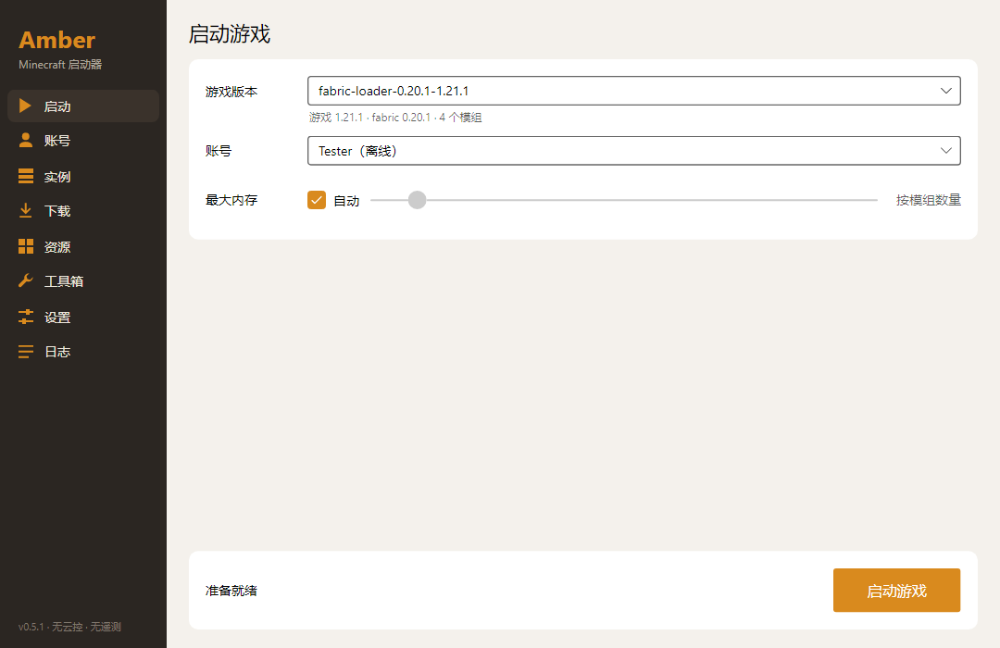
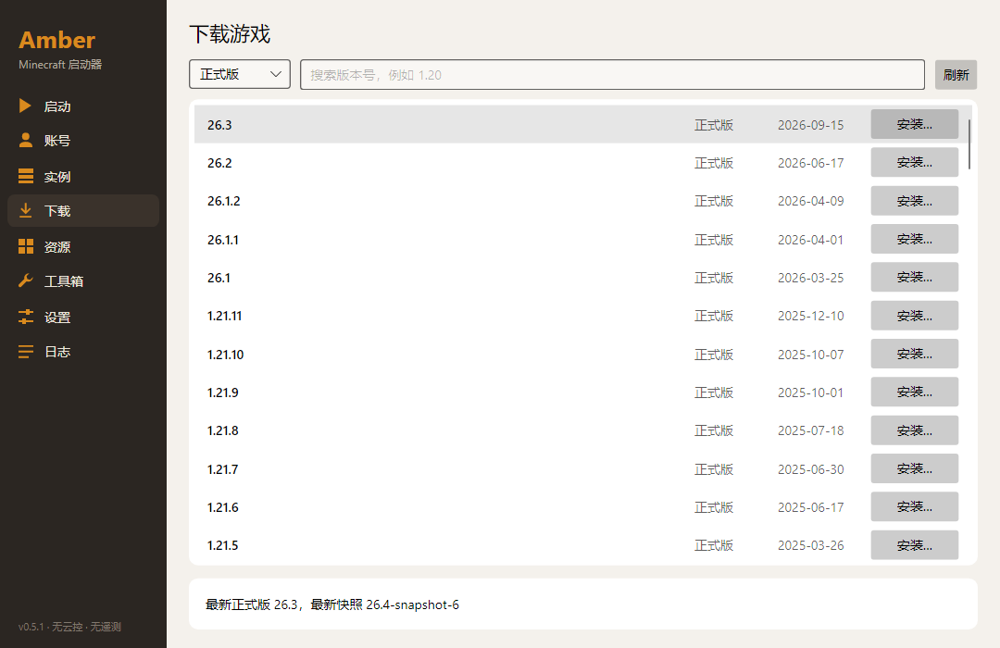
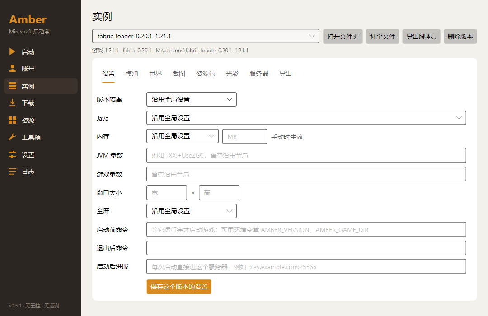
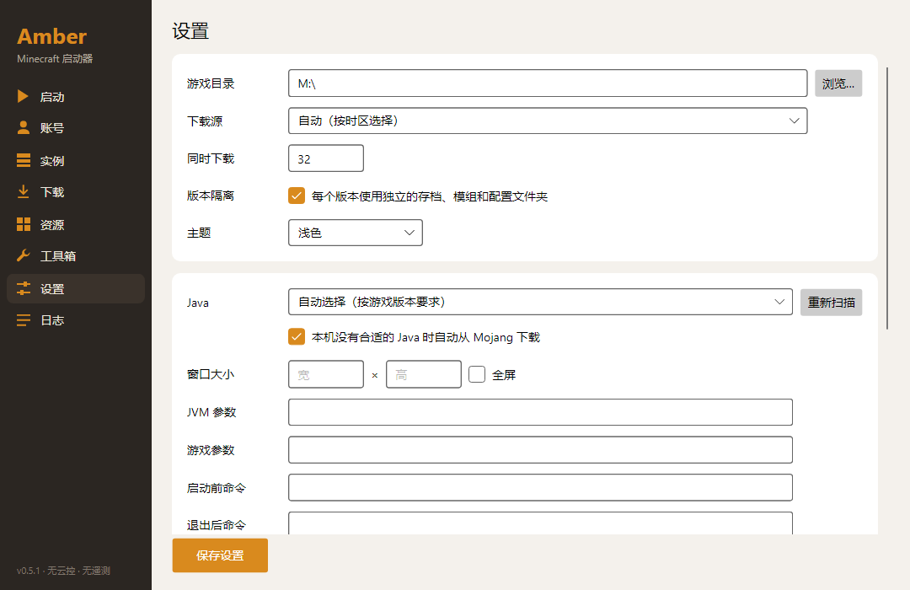

<div align="center">

# Amber

**A clean, lightweight launcher for Minecraft: Java Edition**

No telemetry, no remote switches, one file to download.

[](https://github.com/warriorleavestar/amber-launcher/releases/latest)
[](LICENSE)


[简体中文](README.md) | English



</div>

> The Amber interface is currently in Simplified Chinese only.

## Download

1. Get `Amber.exe` from [Releases](https://github.com/warriorleavestar/amber-launcher/releases/latest).
2. Run it. There is nothing to install, and you don't need .NET.

Amber needs 64-bit Windows 10 or later. You don't need to set up Java either: Amber picks a suitable local Java for each game version and downloads one if none fits.

## Features

### Versions and loaders

- Install releases and snapshots
- One-click Fabric, Quilt, Forge (1.6 and later), NeoForge and OptiFine
- Optional separate saves, mods and config folders for each version

### Accounts

- Microsoft (device code), authlib-injector and offline accounts
- Multiple accounts and skin preview
- Passwords are never stored, and login tokens are encrypted with Windows DPAPI

### Mods and modpacks

- Search and install mods, resource packs, shaders, data packs and modpacks from Modrinth and CurseForge, with required dependencies
- Import mrpack, CurseForge, MultiMC / Prism Launcher instances, HMCL and MCBBS modpacks; export mrpack and CurseForge
- Manage the mods in each instance and the data packs in each world (enable, disable, delete)

### Game management and crash analysis

- Per-version Java, memory, JVM arguments, window size and pre-launch / post-exit commands
- Manage worlds, screenshots, resource packs, shaders and server lists
- Find the likely cause of a crash, list suspect mods and export an error report
- Toolbox: clean up game junk, download files, install Java ahead of time

### Multiplayer

- Play together without being on the same LAN: the host opens the world to LAN, creates a room and shares the room code; friends paste the code to join
- Built on the open-source networking tool [EasyTier](https://github.com/EasyTier/EasyTier), downloaded from its GitHub releases and verified on first use; the default mode needs no admin rights and installs no driver
- Room chat: peer-to-peer, no server in between, with messages additionally encrypted with the room secret
- Optional full-LAN mode: everyone gets a virtual IP and games' LAN broadcasts are forwarded, so other LAN games and apps work too (needs admin rights); members can also route their internet traffic through one member's PC (exit node, opt-in on both sides)
- You add the relay nodes yourself: the [node folder](node/README.md) has one-step scripts for Linux, Docker and Windows, and a share code to send to friends

### Downloads

- Parallel chunked downloads, resume and SHA1 verification
- Choose the official source or the BMCLAPI mirror, or pick automatically by time zone, with automatic fallback on failure

## Screenshots

| Download | Instance settings |
|---|---|
|  |  |



## Privacy

- **No telemetry:** Amber collects no usage data and creates no device ID.
- **No remote control:** no remote switch or cloud config can change what Amber does. The time zone is only used to pick the default download source.
- **Updates are up to you:** Amber doesn't check for updates unless you set an update URL, and even then it only tells you. It never downloads or replaces anything by itself.
- **Network access only for what you're doing:** signing in, fetching version lists, downloading and searching. The services involved are Microsoft and Xbox sign-in, any skin site you add, Mojang's game file servers, your chosen download source, loader download sites (OptiFine via BMCLAPI, authlib-injector via its official site or BMCLAPI), Modrinth and CurseForge.
- **Multiplayer only connects to nodes you added:** only while you host or join a room on the Multiplayer page, Amber connects to the relay nodes you added there and to the other players in the room. Amber ships no nodes and fetches no node list; room codes are generated randomly on your computer and never pass through an Amber server (Amber has none). The EasyTier component is downloaded from the releases page of `github.com/EasyTier/EasyTier`.

The code is open source, so you can check all of this yourself.

## Configuration

Most features need no setup. Both of these are optional:

| Item | Where | Environment variable | Notes |
|---|---|---|---|
| Microsoft Client ID | Accounts page | `AMBER_MS_CLIENT_ID` | A built-in default is used if empty. Order: UI, then environment variable, then default |
| CurseForge API key | Settings page | `AMBER_CF_KEY` | Free from [console.curseforge.com](https://console.curseforge.com). CurseForge is unavailable without one; everything else still works |

Settings are stored in `%APPDATA%\Amber\settings.json`.

## Build from source

You need the [.NET 10 SDK](https://dotnet.microsoft.com/download).

```powershell
git clone https://github.com/warriorleavestar/amber-launcher.git
cd amber-launcher\src
dotnet build
dotnet test
dotnet run --project Amber.App
```

To package a single exe:

```powershell
dotnet publish Amber.App -c Release -r win-x64 --self-contained -p:PublishSingleFile=true -p:IncludeNativeLibrariesForSelfExtract=true -p:PublishReadyToRun=true -p:DebugType=none -o ..\publish
```

There is also a command-line version, for example `dotnet run --project Amber.Cli -- list-remote`.

Amber is built with C#, .NET 10 and [Avalonia](https://avaloniaui.net/).

## FAQ

**Windows says it protected my PC. What should I do?**
Amber isn't code-signed, so SmartScreen may block it. Make sure you downloaded it from this project's Releases, then choose "More info" → "Run anyway".

**Why is the exe so large?**
It includes the .NET runtime and UI libraries, so you don't have to install anything else.

**Can I use my existing `.minecraft` folder?**
Yes. Point the game directory at it on the Settings page.

**Microsoft sign-in fails. What can I try?**
Read the error message and make sure the account owns Minecraft. You can also use your own Azure app: register a public client that allows personal accounts, has device code flow enabled and has Minecraft API access, then enter its Client ID on the Accounts page.

**Why can't I find anything on CurseForge?**
The CurseForge API needs a key; see [Configuration](#configuration). Modrinth doesn't.

**Downloads are slow. What can I do?**
Switch the download source on the Settings page and try the official source or the BMCLAPI mirror.

**Does it run on macOS or Linux?**
Only Windows builds are available for now.

**What isn't supported yet?**
Forge 1.5.2 and earlier.

## License

[MIT](LICENSE)

The multiplayer feature uses EasyTier, a separate open-source project (LGPL-3.0). Amber does not bundle it; it is downloaded separately the first time you use multiplayer.

---

Amber is not an official Minecraft product and is not affiliated with Mojang or Microsoft.
