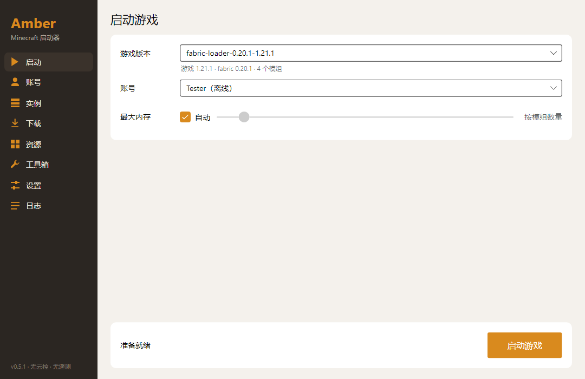
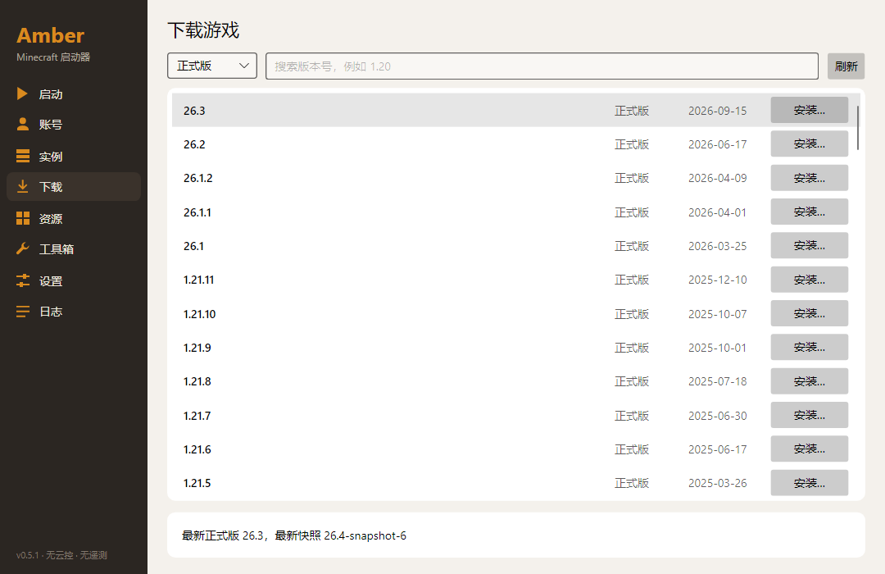
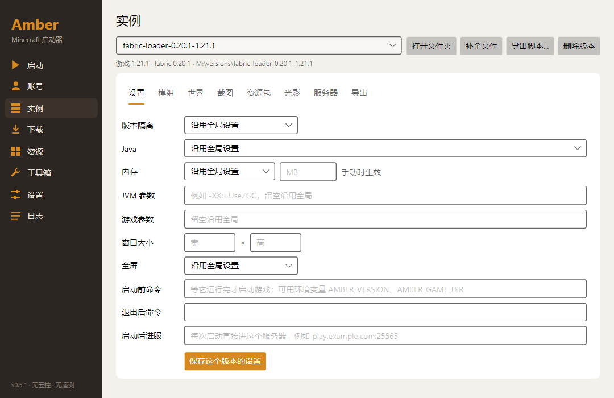
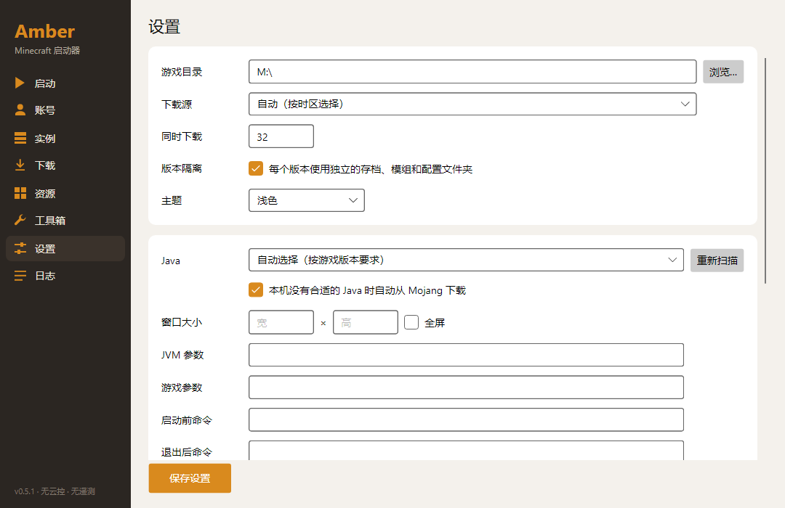

<div align="center">

# Amber

**干净、轻快的 Minecraft Java 版启动器**

没有遥测，没有远程开关，下载一个文件就能用。

[](https://github.com/warriorleavestar/amber-launcher/releases/latest)
[](LICENSE)


简体中文 | [English](README.en.md)



</div>

## 下载安装

1. 到 [Releases](https://github.com/warriorleavestar/amber-launcher/releases/latest) 下载 `Amber.exe`。
2. 双击运行，不用安装，也不用另外装 .NET。

需要 64 位 Windows 10 或更新的系统。Java 不用提前准备：Amber 会按游戏版本自动选择本机的 Java，没有合适的就下载一个。

## 功能

### 版本与加载器

- 安装正式版和快照版
- 一键安装 Fabric、Quilt、Forge（1.6 及以上）、NeoForge、OptiFine
- 每个版本可以有独立的存档、模组和配置文件夹

### 账号

- 微软账号（设备码登录）、authlib-injector 外置登录、离线账号
- 支持多账号切换和皮肤预览
- 不保存密码，登录令牌用 Windows DPAPI 加密

### 模组与整合包

- 在 Modrinth 和 CurseForge 上搜索、安装模组、资源包、光影、数据包和整合包，自动带上必需的依赖
- 导入 mrpack、CurseForge、MultiMC / Prism Launcher 实例、HMCL 和 MCBBS 整合包；导出 mrpack 和 CurseForge 格式
- 管理实例里的模组，以及每个世界的数据包（启用、禁用、删除）

### 游戏管理与崩溃分析

- 每个版本可以单独设置 Java、内存、JVM 参数、窗口大小，以及启动前后要运行的命令
- 管理世界、截图、资源包、光影和服务器列表
- 游戏崩溃时分析原因、列出疑似模组、导出错误报告
- 工具箱：清理游戏垃圾、下载文件、提前下载 Java

### 联机

- 不在同一个局域网也能一起玩：房主把世界“对局域网开放”后创建房间，把房间码发给朋友，朋友输入房间码就能加入
- 基于开源组网工具 [EasyTier](https://github.com/EasyTier/EasyTier)，第一次使用时从它的 GitHub 发布页下载并校验；默认模式不需要管理员权限，也不安装驱动
- 房间聊天：点对点，不经过任何服务器，消息用房间密码另外加密
- 可选的完整局域网模式：每人一个虚拟 IP，游戏的局域网广播也会转发，其他支持局域网联机的游戏和程序也能互通（需要管理员权限）；还可以让房间成员经某个人的电脑上网（出口节点，双方都要手动开启）
- 联机节点由你自己添加：[node 文件夹](node/README.md)里有 Linux、Docker、Windows 的一键部署脚本，搭好后把节点分享码发给朋友

### 下载

- 分块并发、断点续传、SHA1 校验
- 官方源和 BMCLAPI 镜像可以手动选择，也可以按时区自动选择，失败时自动换源

## 截图

| 下载游戏 | 实例设置 |
|---|---|
|  |  |



## 隐私

- **没有遥测**：不收集使用数据，不生成设备识别码。
- **没有远程控制**：功能不受任何远程开关或云端配置影响。时区只用来选默认下载源。
- **更新由你决定**：默认不检查更新；在设置里填了更新地址才会检查，而且只提示，不会自动下载或替换。
- **联网只为了完成你要做的事**：登录、获取版本列表、下载和搜索。会用到的服务有微软和 Xbox 登录、你添加的皮肤站、Mojang 游戏文件服务器、你选择的下载源、各加载器的下载地址（OptiFine 通过 BMCLAPI，authlib-injector 通过其官方地址或 BMCLAPI），以及 Modrinth 和 CurseForge。
- **联机只连你自己添加的节点**：只有在联机页创建或加入房间时才会连接，连的是你在“联机节点”里添加的节点和房间里的其他玩家。Amber 不内置节点、不从网上拉节点列表，房间码在你的电脑上随机生成，不经过 Amber 的服务器（Amber 没有服务器）。联机组件 EasyTier 从 `github.com/EasyTier/EasyTier` 的发布页下载。

代码完全开源，欢迎自行查看。

## 配置

大部分功能不用任何配置。下面两项是可选的：

| 项目 | 在哪里设置 | 环境变量 | 说明 |
|---|---|---|---|
| 微软 Client ID | 「账号」页 | `AMBER_MS_CLIENT_ID` | 留空使用内置的默认值。优先级：界面填写 > 环境变量 > 默认值 |
| CurseForge API Key | 「设置」页 | `AMBER_CF_KEY` | 到 [console.curseforge.com](https://console.curseforge.com) 免费申请。没有 Key 时不能使用 CurseForge，其他功能不受影响 |

设置保存在 `%APPDATA%\Amber\settings.json`。

## 从源码构建

需要 [.NET 10 SDK](https://dotnet.microsoft.com/download)。

```powershell
git clone https://github.com/warriorleavestar/amber-launcher.git
cd amber-launcher\src
dotnet build
dotnet test
dotnet run --project Amber.App
```

打包成单个 exe：

```powershell
dotnet publish Amber.App -c Release -r win-x64 --self-contained -p:PublishSingleFile=true -p:IncludeNativeLibrariesForSelfExtract=true -p:PublishReadyToRun=true -p:DebugType=none -o ..\publish
```

还有一个命令行版本，例如 `dotnet run --project Amber.Cli -- list-remote`。

项目使用 C#、.NET 10 和 [Avalonia](https://avaloniaui.net/)。

## 常见问题

**Windows 提示“已保护你的电脑”怎么办？**
Amber 的程序没有代码签名，所以 SmartScreen 可能会拦截。确认文件是从本项目的 Releases 下载的，点“更多信息”→“仍要运行”即可。

**exe 为什么这么大？**
.NET 运行时和界面库都打包在里面，所以不用另外安装任何东西。

**可以用我现有的 `.minecraft` 文件夹吗？**
可以，在「设置」页把游戏目录指向它。

**微软账号登录失败怎么办？**
先看提示里的错误信息，并确认这个账号已经拥有 Minecraft。也可以换成你自己的 Azure 应用：注册一个允许个人账号、开启设备码流程、并且有 Minecraft API 访问权限的公共客户端应用，再把 Client ID 填到「账号」页。

**为什么搜不到 CurseForge 的内容？**
CurseForge 的接口需要 API Key，见上面的[配置](#配置)。Modrinth 不需要。

**下载很慢怎么办？**
在「设置」页切换下载源，试试官方源或 BMCLAPI 镜像。

**支持 macOS 和 Linux 吗？**
目前只提供 Windows 版本。

**有哪些暂不支持的功能？**
Forge 1.5.2 及更早的版本。

## 许可证

[MIT](LICENSE)

联机功能使用的 EasyTier 是独立的开源项目（LGPL-3.0），Amber 不内置它，在你第一次使用联机时单独下载。

---

Amber 不是 Minecraft 官方产品，与 Mojang 和 Microsoft 没有关联。
